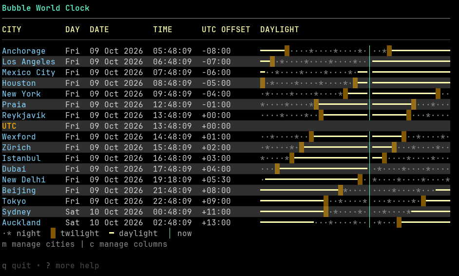

# Bubble World Clock

A terminal world clock built with [Bubble Tea](https://github.com/charmbracelet/bubbletea). Track local dates, times, and UTC offsets for cities from a bundled offline catalog.

Each clock row can include a daylight timeline. Choose a calendar-day view, where daylight stays in place and the now marker moves across the reference city's local day, or a rolling 24-hour view, where the timeline moves beneath a fixed center marker. The legend identifies the reference city.



## Use

Run `bubble-world-clock` (or `bubble-world-clock.exe` on Windows). On the clock screen:

- Press `m` to manage cities, `c` to manage columns, or `f` to set date, time, and timezone formats.
- Press `?` for help. Press `q` or `Ctrl+C` to quit.
- Run `bubble-world-clock update` to check for and install a newer release. Run `bubble-world-clock version` to print the installed version.

### Manage cities

Use the arrow keys or `j`/`k` to select a city. Press `a` to add one, `d` to remove one, `o` to change the sort order, or `u` to show or hide the UTC reference row. UTC is hidden by default and follows the selected sort order. Press `c` for columns, `f` for formats, or Esc to return to the clock.

### Manage columns and daylight

In column settings, use up/down to select a column, Space to show or hide it, and left/right to change its order. City stays first and visible. Press `r` to restore the default columns or `d` to open Daylight settings; the DAYLIGHT column does not need to be selected. Press `m` for city management, `f` for formats, or Esc to return to the clock.

In Daylight settings, use up/down to select a setting. On Timeline mode, left/right switches between:

- **Static daylight, moving now marker:** shows the reference city's local calendar day. The marker moves with the current time.
- **Moving daylight, fixed now marker:** shows a rolling 24-hour timeline centered on the current time.

Press `c` to choose the reference city. Its time zone sets the calendar-day view, and its name appears in the `now (<city>)` legend. It does not need to be on your clock. The defaults are UTC and the calendar-day mode. Press Esc to return to column settings.

### Set date, time, and timezone formats

Use up/down to select date, time, or timezone names, and left/right to choose a format. On Custom, press Enter to edit a Go time layout using the reference `Mon Jan 2 15:04:05 MST 2006`; the screen shows the tokens and a preview. IANA timezone IDs display underscores as spaces. Local timezone abbreviations vary with the date. Press `m` for city management, `c` for columns, or Esc to return to the clock.

### Choose a city

In the city picker, type a city name to search. Use `country:Japan` or `tz:Paris` to filter by country or timezone. Press Enter to add the selected city or set it as the Daylight reference, depending on which screen opened the picker. Press Esc to return to that screen.

If saving fails, press `s` to retry.

Your city list, sort order, UTC setting, daylight settings, column preferences, and display formats are saved in the operating system's user config directory at `BubbleWorldClock/cities.json`. The offline city catalog is derived from GeoNames `cities15000` under CC BY 4.0; see [data/README.md](data/README.md) for attribution.

## Install

Choose an installer below. It downloads the latest stable release, verifies its SHA-256 checksum, and installs the program for the current user without changing saved clock settings. Each example downloads the installer to a temporary file and runs it locally; do not pipe a remote script directly into a shell.

### Linux and macOS

Requires `curl`, `tar`, and `sha256sum` or `shasum`.

```sh
(
	set -e
	installer=$(mktemp "${TMPDIR:-/tmp}/bubbleworldclock-install.XXXXXX")
	trap 'rm -f "$installer"' EXIT HUP INT TERM
	curl -fL https://raw.githubusercontent.com/thomasjdelaney/BubbleWorldClock/master/scripts/install.sh -o "$installer"
	sh "$installer"
)
```

To choose a release version or installation directory:

```sh
(
	set -e
	installer=$(mktemp "${TMPDIR:-/tmp}/bubbleworldclock-install.XXXXXX")
	trap 'rm -f "$installer"' EXIT HUP INT TERM
	curl -fL https://raw.githubusercontent.com/thomasjdelaney/BubbleWorldClock/master/scripts/install.sh -o "$installer"
	sh "$installer" --version v1.2.3 --install-dir "$HOME/bin"
)
```

The default install directory is `~/.local/bin`. The installer adds it to `~/.profile` on Linux or `~/.zprofile` on macOS. Open a new terminal after installation. If you choose a custom directory, add it to PATH yourself.

### Windows

In PowerShell, download the script to a temporary file and run it:

```powershell
$installer = Join-Path ([IO.Path]::GetTempPath()) "bubbleworldclock-install-$([guid]::NewGuid()).ps1"
try {
	Invoke-WebRequest -Uri https://raw.githubusercontent.com/thomasjdelaney/BubbleWorldClock/master/scripts/install.ps1 -OutFile $installer -ErrorAction Stop
	& $installer
} finally {
	Remove-Item -LiteralPath $installer -Force -ErrorAction SilentlyContinue
}
```

If PowerShell blocks script execution, allow scripts for this session only with `Set-ExecutionPolicy -Scope Process -ExecutionPolicy Bypass`, then rerun the download-and-run block.

To choose a release version or installation directory:

```powershell
$installer = Join-Path ([IO.Path]::GetTempPath()) "bubbleworldclock-install-$([guid]::NewGuid()).ps1"
try {
	Invoke-WebRequest -Uri https://raw.githubusercontent.com/thomasjdelaney/BubbleWorldClock/master/scripts/install.ps1 -OutFile $installer -ErrorAction Stop
	& $installer -Version v1.2.3 -InstallDir "$env:LOCALAPPDATA\Programs\BubbleWorldClock"
} finally {
	Remove-Item -LiteralPath $installer -Force -ErrorAction SilentlyContinue
}
```

The default directory is `%LOCALAPPDATA%\Programs\BubbleWorldClock`; the installer adds it to your user PATH. Open a new terminal after installation. Windows ARM64 is not currently supported.

Linux users can also install from the `.deb` or `.rpm` packages on the [releases page](https://github.com/thomasjdelaney/BubbleWorldClock/releases).

## Thanks

Thanks to testers [Brendan Nolan](https://github.com/BrendanNolan), warpworld, and [VeryDave](https://www.twitch.tv/verydave) for their helpful suggestions and feedback.

## Develop

Install Go 1.26.6 or newer, then run:

```sh
go run .
go test ./...
go vet ./...
```

## Release (maintainers)

Push a version tag to publish platform archives, Linux `.deb` and `.rpm` packages, and checksums:

```sh
git tag -a v1.0.0 -m "v1.0.0"
git push origin v1.0.0
```
